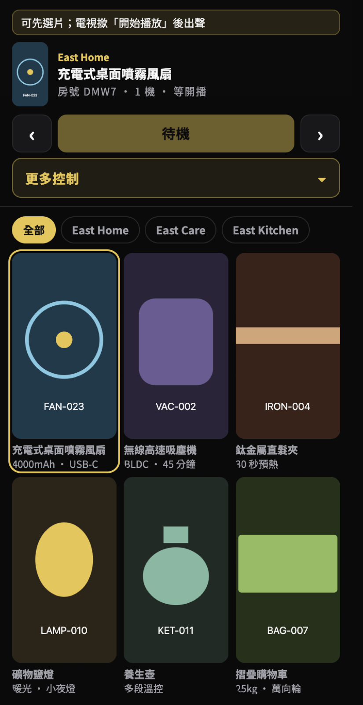

# East Store TV Remote

A phone becomes the remote for an in-store TV ad loop.

This is a **demo**. It is not a live shop. The catalogue, brand, and screenshots are fictional so you can learn the shape of the system and take pictures for a portfolio.

**Problem it solves:** a shop TV needs to play product clips. Staff need next / pause / language without a lost physical remote, and without YouTube TV fighting the next customer’s phone.




## What goes wrong without rooms

USB sticks and YouTube playlists do not know which TV is which.

1. Two TVs in the same shop pick up the same playlist and drift.
2. The remote is physical. Shift change means hunting for it.
3. A clip taken down on YouTube breaks the whole loop.
4. Guests can cast or tap and knock the player off the ad reel.

This project splits the job into three pieces:

1. The **TV page** opens a short room code and a large QR.
2. The **phone remote** joins that room and writes play / pause / next into D1.
3. The **TV polls** the room and plays `/videos/{id}.mp4`.

No account. No app store. A browser on the TV and a browser on a phone are enough.

## What the demo includes

| Screen | Job |
| --- | --- |
| Pairing | Room code + QR. Scan once, then tap the remote. |
| Remote | Filter by line, pick a clip, play / pause / next. |
| Player | HTML5 mp4 from a local folder (empty in the demo). |

Fictional demo catalogue:

- Brand **East Store** (East Home / East Care / East Kitchen)
- Six SKUs: `FAN-023-WH`, `VAC-002`, `IRON-004`, `LAMP-010`, `KET-011`, `BAG-007`
- SVG covers only. Pairing and the remote do not need real videos.

## Run the demo (screenshots only)

You need Node 22+. A Cloudflare account is only required if you later deploy. The local demo uses the placeholder D1 id in `wrangler.jsonc`.

```bash
git clone https://github.com/alexwaved-code/east-store-tv-remote.git
cd east-store-tv-remote
npm install
npm run seed:local
npm run dev
```

Open the printed `localhost` URL. The TV shows a room code. Open `/remote.html?c=ROOM` in another tab (or scan the QR) to see the remote.

This repo is a local demo. Do not point it at a production D1 or a real shop video host.

## How to build one yourself

Copy the idea, not the store.

### 1. Give every TV a room

A room is a short code plus play state: current clip, index, language, pause. Store it in D1. Delete dead rooms. Do not bake shop names into the URL unless you really need a fixed kiosk.

### 2. Keep the catalogue in one file

`public/shared/ads.js` is the buyer-facing list. `functions/_shared/ads.js` is the id list the server shuffles. They must stay in sync. Put covers next to the site. Put mp4s on your own host and change `VIDEO_BASE` in `public/shared/video.js`.

### 3. Let the phone write commands

The remote is not a second player. It posts `play`, `pause`, `next`, `pick` to `/api/sync`. The TV is the only thing that touches `<video>`. That way a dropped phone does not stop the picture if you want it to keep looping.

### 4. Skip the app until the web remote works

The original shop had an Android TV package. This demo does not. Prove the QR loop in a browser first.

## License

MIT. Demo products and covers are fictional and are not a real store.
